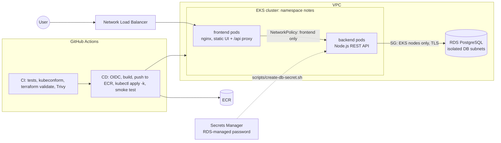

# 3-Tier Application on Amazon EKS with GitHub Actions

A notes app split into the classic three tiers (**nginx web tier**, **Node.js API tier**, **Amazon RDS PostgreSQL data tier**) running on **Amazon EKS**, built and deployed by **GitHub Actions** with **OIDC** (no AWS keys in GitHub). Infrastructure is **Terraform**; Kubernetes config is **Kustomize**; tiers are isolated with **NetworkPolicies** and security groups.

## Architecture



## Highlights

- **Real three-tier separation**: only the web tier is public; the API is reachable only from web pods (NetworkPolicy, default deny); the database only from EKS nodes (security group) in isolated subnets, with no public access.
- **Keyless CI/CD**: GitHub OIDC role trusted only for this repo's `production` environment; ECR push scoped to two repos; EKS access entry gives CI **edit rights in the `notes` namespace only**.
- **Managed secrets**: RDS generates and stores the DB password in Secrets Manager; nothing sensitive is in git.
- **CI on every PR**: backend tests against an in-memory Postgres (`pg-mem`), Kustomize render + `kubeconform` schema check, `terraform fmt/validate`, Docker builds with layer caching, Trivy scans that fail on fixable CRITICALs and upload results to GitHub code scanning.
- **Safe deploys**: rolling updates with zero unavailable pods, readiness probe that checks DB connectivity, automatic `rollout undo` if a rollout fails, smoke test against the public endpoint, single-deploy concurrency, optional required reviewers on the `production` environment.
- **Hardened pods**: restricted Pod Security Standard, non-root, read-only root filesystem, no capabilities.
- **Supply chain**: immutable ECR tags (commit SHA), scan on push, Dependabot for npm, Docker, Actions and Terraform.

## Layout

```
frontend/            nginx (unprivileged) + static UI, proxies /api to backend
backend/             Express API, pg client, tests (pg-mem)
k8s/                 Kustomize: config, deployments, services, network policies
terraform/           VPC, EKS (+ network policy agent), ECR, RDS, GitHub OIDC role
.github/workflows/   ci.yml, cd.yml
scripts/             create-db-secret.sh
docker-compose.yml   run all three tiers locally
```

## Run it

**Prerequisites:** AWS account and CLI, Terraform ≥ 1.6, kubectl.

```bash
# 1. Infrastructure (~20 min)
cd terraform
terraform init
terraform apply -var="github_repo=siphosem/three-tier-eks-github-actions"
# If the account already has a GitHub OIDC provider, add -var="create_github_oidc_provider=false"
$(terraform output -raw configure_kubectl)

# 2. Namespace + database secret (one-time, as cluster admin)
../scripts/create-db-secret.sh
```

3. In GitHub: **Settings → Secrets and variables → Actions → Variables**: add `AWS_DEPLOY_ROLE_ARN` = the `github_deploy_role_arn` output.
4. **Settings → Environments → New environment** `production` (optionally add yourself as a required reviewer).
5. Push to `main`. CI runs, then CD deploys. The app URL is in the CD run summary.

### Run locally

```bash
docker compose up --build      # http://localhost:8080
cd backend && npm ci && npm test
```

## Cost and cleanup

About **US$7–8 per day** (EKS control plane, two t3.medium nodes, db.t4g.micro, NAT gateway, NLB).

```bash
kubectl delete -k k8s && kubectl delete -f k8s/namespace.yaml
sleep 60   # let AWS remove the load balancer
terraform -chdir=terraform destroy
```

## Screenshots

<!-- Add after deploying: CI and CD runs, Trivy results in the Security tab, the app, kubectl get all -n notes, RDS console. -->

## What I learned

<!-- 3-5 bullets in your own words. -->
